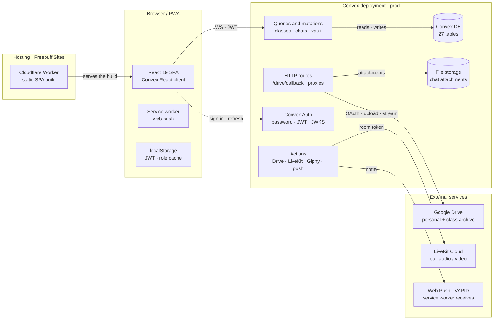

# NatyaVault architecture

One React SPA served from Freebuff Sites, and one Convex deployment that holds
all state and every secret. Media bytes never touch Convex storage — they stay
in Google Drive.

Solid arrows are steady traffic; the dashed arrow is the sign-in and token
refresh path, which only runs when the session starts or the access token
expires.

## What each box is

| Box | What it is |
| --- | --- |
| Cloudflare Worker | The static SPA build served by Freebuff Sites (`natyavault.freebuff.site`). No server-side rendering. |
| React 19 SPA + Convex client | The app (`src/`), talking to the deployment over the Convex WebSocket with a JWT attached. |
| Service worker | Receives Web Push messages for new chat messages and calls. |
| localStorage | Namespaced per deployment: the auth JWT and refresh token, the remembered account, the per-account staff role cache, and the admin unlock. |
| Queries and mutations | `classes`, `chats`, `vault`, `attendance`, `practice`, `admin` — every read and write of app data. |
| HTTP routes | `auth.addHttpRoutes` (OAuth discovery and JWKS), `/drive/callback`, `/drive/upload-proxy`, `/drive/media-proxy`. |
| Convex Auth | The password provider (username + password), self-issued RS256 JWTs, and rotating refresh tokens. |
| Actions | Drive token exchange and refresh, LiveKit room tokens, Giphy search, password resets, and push sends. |
| Google Drive | Where the actual audio and video bytes live: one token set per account, plus a single class-archive token (`vaultDriveTokens`). |

## Flows worth knowing

1. **Sign-in** — the sign-up/sign-in card calls `admin:ensureAdminAccount` for
   the admin handle, then the Convex Auth password provider issues a JWT and a
   refresh token. Both land in `localStorage`; every query, mutation and action
   carries the JWT.
2. **Upload** — the browser PUTs bytes to `/drive/upload-proxy`, which streams
   them straight into a Google resumable upload session. The bytes are never
   buffered inside a Convex function.
3. **Playback** — an `<audio>`/`<video>` element requests
   `/drive/media-proxy?grant=…`. The route resolves the short-lived
   `mediaGrants` row, mints the right Drive token (class archive or uploader)
   and streams the file with an `Authorization` header, forwarding `Range` so
   seeking works. Google rejects `access_token` as a query parameter, which is
   why the relay exists.
4. **Calls** — an action mints a LiveKit room token (the room name is derived
   from the chat id). Audio and video then flow browser ↔ LiveKit directly.
5. **Push** — the service worker subscribes with the deployment's VAPID keys;
   a Convex action sends an encrypted notification to each `pushSubscriptions`
   row for the chat.

## Tables

`src/convex/schema.ts` defines 21 tables, one of which is `users` (overriding
the auth library's own). `authTables` contributes six more —
`authSessions`, `authAccounts`, `authRefreshTokens`, `authVerificationCodes`,
`authVerifiers`, `authRateLimits` — for **27 tables** in total.

## Secrets

Every credential is a Convex environment variable — the JWT key pair, the VAPID
pair, the Google OAuth client, LiveKit, and GIPHY. The static bundle contains
only the deployment URL, so none of them can leak from the app build.
