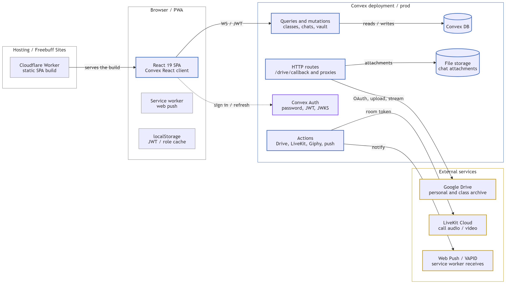
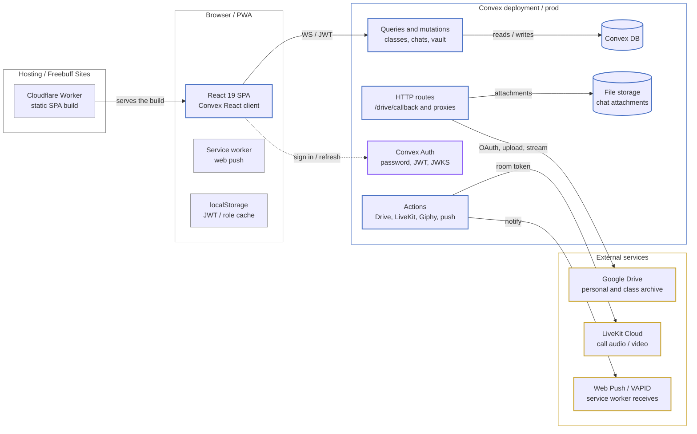

# NatyaVault architecture

One React SPA served from Freebuff Sites, and one Convex deployment that holds
all state and every secret. Media bytes never touch Convex storage — they stay
in Google Drive.



<details>
<summary>Diagram source (Mermaid)</summary>



</details>

Solid arrows are steady traffic; the dashed arrow is the sign-in and token
refresh path, which only runs when the session starts or the access token
expires. Blue is the app and its database, purple is auth, yellow is an outside
service, grey is a browser or edge runtime.

<!-- BEGIN GENERATED COUNTS -->
The deployment has **27 tables** — 21 defined in
`src/convex/schema.ts` (including `users`) and 6 more that
Convex Auth adds.

Field-level detail, references and indexes live in [data-model.md](data-model.md).
This count is generated from the schema, not typed by hand.
<!-- END GENERATED COUNTS -->

## What each box is

| Box | What it is |
| --- | --- |
| Cloudflare Worker | The static SPA build served by Freebuff Sites (`natyavault.freebuff.site`). No server-side rendering. |
| React 19 SPA + Convex client | The app (`src/`), talking to the deployment over the Convex WebSocket with a JWT attached. |
| Service worker | Receives Web Push messages for new chat messages and calls. |
| localStorage | Namespaced per deployment: the auth JWT and refresh token, the remembered account, the per-account staff role cache, and the admin unlock. |
| Queries and mutations | `classes`, `chats`, `vault`, `attendance`, `practice`, `admin` — every read and write of app data. |
| HTTP routes | `auth.addHttpRoutes` for OAuth discovery and JWKS, plus the Drive routes listed under [Backend surface](#backend-surface). |
| Convex Auth | The password provider (username and password), self-issued RS256 JWTs, and rotating refresh tokens. |
| Actions | Drive token exchange and refresh, LiveKit room tokens, Giphy search, password resets, and push sends. |
| Google Drive | Where the actual audio and video bytes live: one token set per account, plus a single class-archive token (`vaultDriveTokens`). |

## Backend surface

Every function the deployment exposes, and every HTTP route, read out of
`src/convex/`.

<!-- BEGIN GENERATED BACKEND -->
**81 public functions**, 32
internal helpers — 27 queries, 37 mutations and
17 actions across 17 modules in `src/convex/`.

| module | queries | mutations | actions | internal |
| --- | --- | --- | --- | --- |
| `admin.ts` | `hasAdminAccess`, `practiceLogEnabled`, `publicMode`, `gifsEnabled`, `listAccounts` | `claimAdminAccess`, `setPracticeLogEnabled`, `setPublicMode`, `setGifsEnabled`, `deleteAccount` | `verify`, `ensureAdminAccount`, `resetPassword` | `signedInIsAdmin`, `stampAdminRole`, `adminAccountExists`, `resetTarget` |
| `attendance.ts` | `classAttendance` | `setMark`, `clearMark`, `addStudent`, `removeStudent`, `clearClassAttendance` | — | — |
| `callState.ts` | `live` | `start`, `touch`, `end` | — | `session` |
| `calls.ts` | — | — | `token` | — |
| `chats.ts` | `people`, `myChats`, `unreadTotal`, `thread`, `details` | `ensureClassChat`, `ensureAllClassChats`, `createChat`, `addMembers`, `removeMember`, `rename`, `remove`, `send`, `markRead`, `setPinned`, `removeMessage`, `uploadUrl` | — | — |
| `classes.ts` | `validateCode`, `myClasses`, `allClasses`, `viewerRole`, `classSheet` | `createClass`, `deleteClass`, `joinClass` | — | `joinOnSignUp` |
| `drive.ts` | `status`, `files` | — | `authUrl`, `exchange`, `disconnect`, `startUpload`, `finishUpload`, `cancelUpload`, `fileUrl`, `disconnectVault`, `remove`, `browse`, `listSubtree` | `getTokens`, `saveTokens`, `createState`, `consumeState`, `peekState`, `getVaultTokens`, `saveVaultTokens`, `clearVaultTokens`, `viewerManagesClasses`, `forgetTokens`, `clearTokens`, `listFiles`, `recordFile`, `forgetFile`, `createGrant`, `grantFor`, `tokenForGrant`, `removeForOwner` |
| `gifs.ts` | — | — | `search` | — |
| `names.ts` | `needsFullName` | `setFullName` | — | — |
| `passwords.ts` | — | — | — | `record` |
| `practice.ts` | `classPractice` | `addEntry`, `removeEntry`, `importLocal` | — | — |
| `push.ts` | `publicKey`, `devices` | `subscribe`, `unsubscribe` | — | `recipients`, `removeDead` |
| `pushSend.ts` | — | — | — | `send` |
| `tour.ts` | `pending` | `finish` | — | — |
| `usernames.ts` | `isTaken` | — | — | — |
| `users.ts` | `currentUser` | — | — | — |
| `vault.ts` | `classMedia` | `addShared`, `renameShared` | `removeShared` | `removable`, `dropRow`, `byDriveFile`, `memberFor` |

HTTP routes registered in `http.ts` (4):

| method | path |
| --- | --- |
| OPTIONS | `/drive/upload-proxy` |
| PUT | `/drive/upload-proxy` |
| GET | `/drive/media-proxy` |
| GET | `/drive/callback` |

Generated from the source, so a new function or route appears here — or
`npm run docs:data-model:check` fails.
<!-- END GENERATED BACKEND -->

## Pages

<!-- BEGIN GENERATED PAGES -->
The React Router tree in `src/main.tsx`, with the guard in front of each
page.

| path | page | who gets in |
| --- | --- | --- |
| `/` | `Landing` | public |
| `/auth` | `AuthPage` | public |
| `/dashboard` | `AppShell` | signed in |
| `/dashboard` | `Dashboard` | signed in |
| `/dashboard/practice` | `PracticeLog` | signed in |
| `/dashboard/attendance` | `Attendance` | signed in |
| `/dashboard/classes` | `Classes` | signed in |
| `/dashboard/vault` | `MediaVault` | signed in |
| `/dashboard/messages` | `Messages` | signed in |
| `/dashboard/admin` | `Admin` | admin |
| `/*` | `NotFound` | public |
<!-- END GENERATED PAGES -->

## Flows worth knowing

1. **Sign-in** — the sign-up/sign-in card calls `admin:ensureAdminAccount` for
   the admin handle, then the Convex Auth password provider issues a JWT and a
   refresh token. Both land in `localStorage`; every query, mutation and action
   carries the JWT.
2. **Upload** — the browser PUTs bytes to `/drive/upload-proxy`, which streams
   them straight into a Google resumable upload session. The bytes are never
   buffered inside a Convex function.
3. **Playback** — an `<audio>`/`<video>` element requests
   `/drive/media-proxy?grant=…`. The route resolves the short-lived
   `mediaGrants` row, mints the right Drive token (class archive or uploader)
   and streams the file with an `Authorization` header, forwarding `Range` so
   seeking works. Google rejects `access_token` as a query parameter, which is
   why the relay exists.
4. **Calls** — an action mints a LiveKit room token (the room name is derived
   from the chat id). Audio and video then flow browser ↔ LiveKit directly.
5. **Push** — the service worker subscribes with the deployment's VAPID keys;
   a Convex action sends an encrypted notification to each `pushSubscriptions`
   row for the chat.

## Tables

Field-level detail, references and indexes: [data-model.md](data-model.md).

## How this stays current

The table count, the backend surface and the page list above are generated from
the code — `src/convex/schema.ts`, `src/convex/*.ts` and `src/main.tsx` — and so
is every diagram in [data-model.md](data-model.md).

```bash
npm run docs:data-model        # rewrite the generated sections and docs/diagrams.html
npm run docs:data-model:check  # exit 1 when anything is stale
```

`check` runs before every commit, so a code change cannot land with stale docs.
It compares the generated blocks against a fresh read of the source, and it
compares each exported SVG against the diagram source stamped inside it
(`<!-- source:… -->`). When a diagram has changed, re-export the images from
`docs/diagrams.html` — press **Download SVG** on each card — and commit them
with the change.

Turn the hook on once per clone:

```bash
git config core.hooksPath .githooks
```

## Secrets

Every credential is a Convex environment variable — the JWT key pair, the VAPID
pair, the Google OAuth client, LiveKit, and GIPHY. The static bundle contains
only the deployment URL, so none of them can leak from the app build.
