# NatyaVault data model

Two views of the same thing. The **conceptual model** names what the school
talks about — classes, students, media, practice — without caring how it is
stored. The **physical model** is generated from `src/convex/schema.ts`, so it
cannot drift from the code.

## Conceptual model

An account belongs to one class, or owns several if it teaches. A class holds
its media, its practice log, its attendance sheet, a hand-added roster and one
chat room of its own; accounts also hold their own Drive connection, push
devices and admin grant.

```mermaid
erDiagram
  ACCOUNT ||--o{ CLASS : "owns"
  ACCOUNT ||--o{ ENROLMENT : "joins"
  CLASS ||--o{ ENROLMENT : "has"
  ACCOUNT ||--o{ PRACTICE_SESSION : "logs"
  CLASS ||--o{ PRACTICE_SESSION : "collects"
  CLASS ||--o{ ATTENDANCE_MARK : "records"
  CLASS ||--o{ MEDIA_ITEM : "archives"
  ACCOUNT ||--o{ MEDIA_ITEM : "uploads"
  CLASS ||--o| CHAT : "one room"
  CHAT ||--o{ CHAT_MEMBER : "seats"
  ACCOUNT ||--o{ CHAT_MEMBER : "sits in"
  CHAT ||--o{ MESSAGE : "holds"
  ACCOUNT ||--o{ MESSAGE : "sends"
  CLASS ||--o{ EXTRA_NAME : "roster entry"
  ACCOUNT ||--o| DRIVE_CONNECTION : "connects"
  ACCOUNT ||--o{ PUSH_DEVICE : "registers"
  ACCOUNT ||--o| ADMIN_GRANT : "may hold"
```

| Entity | What it stands for |
| --- | --- |
| `ACCOUNT` | One person who signs in: a student, a teacher, or the admin. |
| `CLASS` | A class with a six-character code students type at sign-up. |
| `ENROLMENT` | The link between an account and the one class it belongs to. |
| `ATTENDANCE_MARK` | One person's status on one class day: present, late, absent or away. |
| `PRACTICE_SESSION` | Minutes practised on a date, with what was practised. |
| `MEDIA_ITEM` | An audio or video upload in a class's archive. The bytes live in Drive; this is the record of them. |
| `CHAT` | A class's own room, or a group/solo conversation started by staff. |
| `CHAT_MEMBER` | Who sits in a chat, and since when. |
| `MESSAGE` | Anything posted in a chat: text, a file, a GIF, a deleted tombstone. |
| `EXTRA_NAME` | A name a teacher added to the attendance sheet for someone without an account yet. |
| `DRIVE_CONNECTION` | The Google Drive an account (or the class archive) uploads through. |
| `PUSH_DEVICE` | One browser that agreed to receive chat notifications. |
| `ADMIN_GRANT` | A 90-day admin unlock earned by entering the admin credentials. |

## Physical model

Every table the deployment defines, with its fields and references, generated
from the schema.

<!-- BEGIN GENERATED DATA MODEL -->
**27 tables** — 21 defined in `src/convex/schema.ts` (including
`users`) plus 6 from Convex Auth's `authTables` (`authSessions`, `authAccounts`, `authRefreshTokens`, `authVerificationCodes`, `authVerifiers`, `authRateLimits`).

```mermaid
erDiagram
  users {
    id _id PK
    number _creationTime
    string name "optional"
    string image "optional"
    string email "optional"
    number emailVerificationTime "optional"
    bool isAnonymous "optional"
    enum role "admin, user, member; optional"
    enum classRole "teacher, student; optional"
    bool fullNameSet "optional"
    bool tourPending "optional"
  }
  authSessions {
    id _id PK
    number _creationTime
    id userId FK "-> users"
    number expirationTime
  }
  authAccounts {
    id _id PK
    number _creationTime
    id userId FK "-> users"
    string provider
    string providerAccountId
    string secret "optional"
    string emailVerified "optional"
    string phoneVerified "optional"
  }
  authRefreshTokens {
    id _id PK
    number _creationTime
    id sessionId FK "-> authSessions"
    number expirationTime
    number firstUsedTime "optional"
    id parentRefreshTokenId FK "-> authRefreshTokens; optional"
  }
  authVerificationCodes {
    id _id PK
    number _creationTime
    id accountId FK "-> authAccounts"
    string provider
    string code
    number expirationTime
    string verifier "optional"
    string emailVerified "optional"
    string phoneVerified "optional"
  }
  authVerifiers {
    id _id PK
    number _creationTime
    id sessionId FK "-> authSessions; optional"
    string signature "optional"
  }
  authRateLimits {
    id _id PK
    number _creationTime
    string identifier
    number lastAttemptTime
    number attemptsLeft
  }
  savedPasswords {
    id _id PK
    number _creationTime
    string username
    string password
    number updatedAt
  }
  driveTokens {
    id _id PK
    number _creationTime
    id userId FK "-> users"
    string accessToken
    string refreshToken
    number expiresAt
    string scope
    string email "optional"
    number updatedAt
  }
  vaultDriveTokens {
    id _id PK
    number _creationTime
    string key
    string accessToken
    string refreshToken
    number expiresAt
    string scope
    string email "optional"
    id connectedBy FK "-> users; optional"
    number updatedAt
  }
  adminUnlocks {
    id _id PK
    number _creationTime
    id userId FK "-> users"
    number grantedAt
    number expiresAt
  }
  mediaGrants {
    id _id PK
    number _creationTime
    string token
    string fileId
    id ownerUserId FK "-> users; optional"
    number expiresAt
    number createdAt
  }
  driveStates {
    id _id PK
    number _creationTime
    string nonce
    id userId FK "-> users"
    string returnTo
    string origin "optional"
    string mode "optional"
    number createdAt
  }
  driveFiles {
    id _id PK
    number _creationTime
    id userId FK "-> users"
    string fileId
    string name
    string mimeType
    number size "optional"
    number createdAt
  }
  classes {
    id _id PK
    number _creationTime
    string code
    string name
    id ownerId FK "-> users"
    string ownerName
    number createdAt
  }
  attendanceMarks {
    id _id PK
    number _creationTime
    string code
    string date
    string name
    enum status "present, late, absent, away"
    string markedBy
    number updatedAt
  }
  practiceEntries {
    id _id PK
    number _creationTime
    string code
    id authorId FK "-> users"
    string authorName
    string date
    number minutes
    string item
    number createdAt
    string clientId "optional"
  }
  vaultMedia {
    id _id PK
    number _creationTime
    string code
    enum kind "audio, video"
    string title
    string mimeType
    string driveFileId
    enum owner "vault, uploader; optional"
    id uploaderId FK "-> users"
    string uploaderName
    string date
    number createdAt
  }
  classStudents {
    id _id PK
    number _creationTime
    string code
    string name
    string addedBy
    number addedAt
  }
  classMembers {
    id _id PK
    number _creationTime
    id userId FK "-> users"
    string code
    string className
    number joinedAt
  }
  chats {
    id _id PK
    number _creationTime
    enum kind "group, solo"
    string title
    string classCode "optional"
    id createdBy FK "-> users"
    string createdByName
    number createdAt
    number lastMessageAt
    string lastMessageText
    string lastMessageAuthor
    string soloKey "optional"
  }
  chatMembers {
    id _id PK
    number _creationTime
    id chatId FK "-> chats"
    id userId FK "-> users"
    string name
    number joinedAt
    number leftAt "optional"
    number hiddenAt "optional"
    number removedAt "optional"
  }
  chatMessages {
    id _id PK
    number _creationTime
    id chatId FK "-> chats"
    id authorId FK "-> users"
    string authorName
    bool authorIsStaff
    string text
    number createdAt
    bool pinned
    object attachment "storageId, name, mimeType, size; optional"
    object gif "url, previewUrl, width, height, alt; optional"
    enum deletedBy "author, staff; optional"
    string deletedByName "optional"
  }
  chatReads {
    id _id PK
    number _creationTime
    id chatId FK "-> chats"
    id userId FK "-> users"
    number lastReadAt
  }
  calls {
    id _id PK
    number _creationTime
    id chatId FK "-> chats"
    string roomName
    id startedBy FK "-> users"
    string startedByName
    number startedAt
    number heartbeatAt
    number endedAt "optional"
  }
  pushSubscriptions {
    id _id PK
    number _creationTime
    id userId FK "-> users"
    string endpoint
    string p256dh
    string auth
    string userAgent "optional"
    number createdAt
  }
  settings {
    id _id PK
    number _creationTime
    string key
    bool enabled
    number updatedAt
  }
  users ||--o{ authSessions : "userId"
  users ||--o{ authAccounts : "userId"
  authSessions ||--o{ authRefreshTokens : "sessionId"
  authRefreshTokens ||--o{ authRefreshTokens : "parentRefreshTokenId"
  authAccounts ||--o{ authVerificationCodes : "accountId"
  authSessions ||--o{ authVerifiers : "sessionId"
  users ||--o{ driveTokens : "userId"
  users ||--o{ vaultDriveTokens : "connectedBy"
  users ||--o{ adminUnlocks : "userId"
  users ||--o{ mediaGrants : "ownerUserId"
  users ||--o{ driveStates : "userId"
  users ||--o{ driveFiles : "userId"
  users ||--o{ classes : "ownerId"
  users ||--o{ practiceEntries : "authorId"
  users ||--o{ vaultMedia : "uploaderId"
  users ||--o{ classMembers : "userId"
  users ||--o{ chats : "createdBy"
  chats ||--o{ chatMembers : "chatId"
  users ||--o{ chatMembers : "userId"
  chats ||--o{ chatMessages : "chatId"
  users ||--o{ chatMessages : "authorId"
  chats ||--o{ chatReads : "chatId"
  users ||--o{ chatReads : "userId"
  chats ||--o{ calls : "chatId"
  users ||--o{ calls : "startedBy"
  users ||--o{ pushSubscriptions : "userId"
```



### Indexes

| table | indexes |
| --- | --- |
| `users` | `email(email)` |
| `authSessions` | `userId(userId)` |
| `authAccounts` | `userIdAndProvider(userId, provider)`, `providerAndAccountId(provider, providerAccountId)` |
| `authRefreshTokens` | `sessionId(sessionId)`, `sessionIdAndParentRefreshTokenId(sessionId, parentRefreshTokenId)` |
| `authVerificationCodes` | `accountId(accountId)`, `code(code)` |
| `authVerifiers` | `signature(signature)` |
| `authRateLimits` | `identifier(identifier)` |
| `savedPasswords` | `by_username(username)` |
| `driveTokens` | `by_user(userId)` |
| `vaultDriveTokens` | `by_key(key)` |
| `adminUnlocks` | `by_user(userId)` |
| `mediaGrants` | `by_token(token)` |
| `driveStates` | `by_nonce(nonce)` |
| `driveFiles` | `by_user(userId)` |
| `classes` | `by_code(code)`, `by_owner(ownerId)` |
| `attendanceMarks` | `by_code(code)`, `by_code_and_date(code, date)` |
| `practiceEntries` | `by_code(code)`, `by_code_and_date(code, date)`, `by_client(clientId)` |
| `vaultMedia` | `by_code(code)`, `by_drive_file(driveFileId)`, `by_uploader(uploaderId)` |
| `classStudents` | `by_code(code)` |
| `classMembers` | `by_user(userId)`, `by_code(code)` |
| `chats` | `by_class(classCode)`, `by_solo_key(soloKey)`, `by_last_message(lastMessageAt)` |
| `chatMembers` | `by_chat(chatId)`, `by_user(userId)`, `by_chat_user(chatId, userId)` |
| `chatMessages` | `by_chat_time(chatId, createdAt)` |
| `chatReads` | `by_chat_user(chatId, userId)`, `by_user(userId)` |
| `calls` | `by_chat_started(chatId, startedAt)` |
| `pushSubscriptions` | `by_user(userId)`, `by_endpoint(endpoint)` |
| `settings` | `by_key(key)` |
<!-- END GENERATED DATA MODEL -->

## Keeping it current

The section above is written by `npm run docs:data-model`, which reads
`src/convex/schema.ts` — add a table or a field there and the diagram follows.

```bash
npm run docs:data-model        # rewrite the generated sections
npm run docs:data-model:check  # exit 1 if the docs are stale (for CI)
```

`docs/architecture.md` holds its table count the same way, so the two documents
always agree with the schema.
